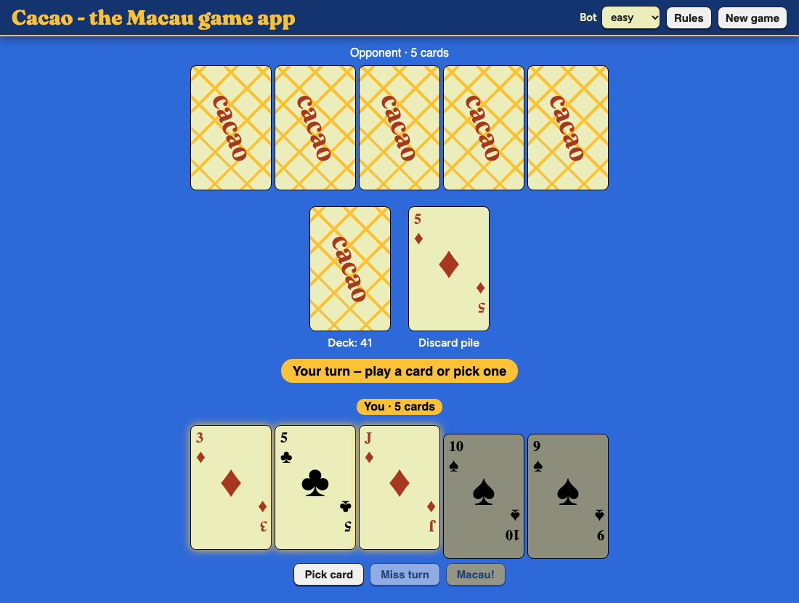
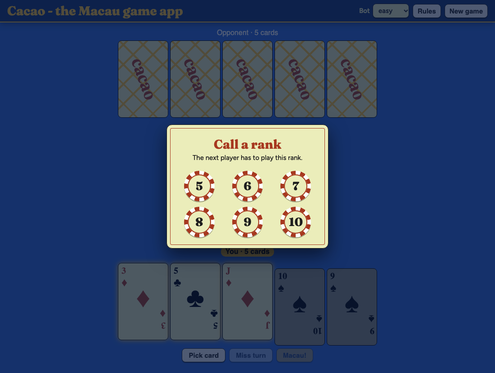
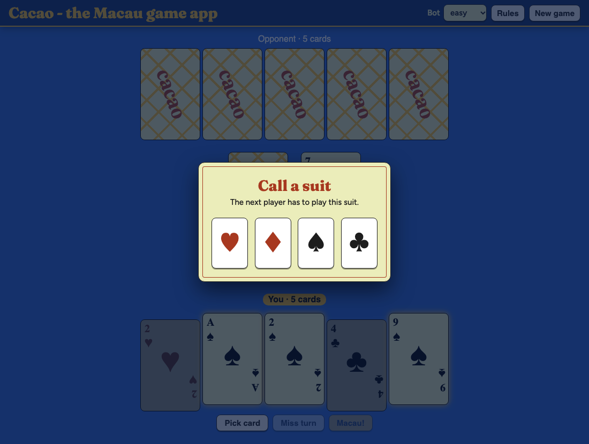
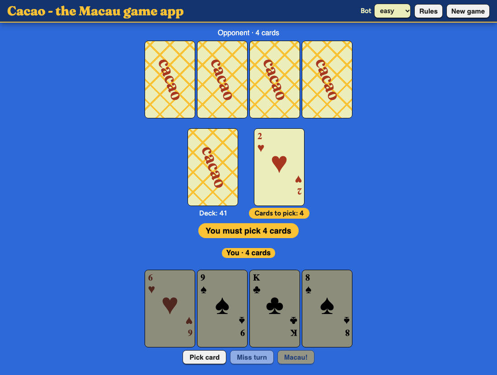

# Cacao – Macau card game

A single-player [Macau](<https://en.wikipedia.org/wiki/Macau_(card_game)>) game
against a bot, in the browser. Get rid of all your cards before the bot does:
play a card that matches the rank or suit of the top card, or pick one from the
deck. The special cards are listed under _Rules_ in the app, and the full game
is described on [Wikipedia](<https://en.wikipedia.org/wiki/Macau_(card_game)>).



<p>
  
  
</p>



## Run it!

Requires Node.js 22.

```sh
npm ci
```

```sh
npm start
```

App starts on http://localhost:4200.

## Tests

```sh
npm test                             # unit tests
```

```sh
npx playwright install chromium      # once, for the end-to-end tests
```

```sh
npm run e2e                          # end-to-end tests
```
