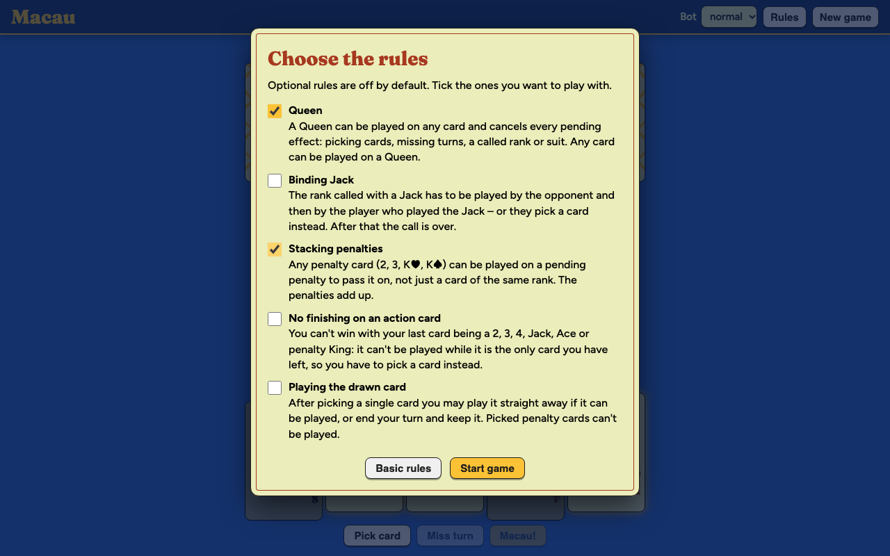

# Macau card game

A single-player Macau game against a bot, in the browser. Get rid of all your cards before the bot does:
play a card that matches the rank or suit of the top card, or pick one from the
deck. The special cards are listed under _Rules_ in the app, and the full game
is described on [Wikipedia](<https://en.wikipedia.org/wiki/Macau_(card_game)>).


<p>
  
  
</p>


## Optional rules

Before each game a dialog asks which variants to play with. All of them are off by default.

| Rule                           | Effect                                                                                                                                            |
| ------------------------------ | ------------------------------------------------------------------------------------------------------------------------------------------------- |
| Queen                          | A Queen goes on any card and cancels every pending effect (penalty, miss, called rank or suit). Any card goes on a Queen.                         |
| Binding Jack                   | The rank called with a Jack has to be played by the opponent and then by the player who played the Jack, or they pick a card instead.             |
| Stacking penalties             | Any penalty card (2, 3, K♥, K♠) can be played on a pending penalty, not just one of the same rank. The penalties add up.                          |
| No finishing on an action card | The last card in hand can't be a 2, 3, 4, Jack, Ace or penalty King; it can't be played while it is the only one left.                            |
| Playing the drawn card         | After picking a single card you may play it at once if it is legal, or end the turn and keep it. The bot on Easy always keeps the card it picked. |



## Run it!

Requires Node.js 22.

```sh
npm ci
```

```sh
npm start
```

App starts on http://localhost:4200.

## Tests

```sh
npm test                             # unit tests
```

```sh
npx playwright install chromium      # once, for the end-to-end tests
```

```sh
npm run e2e                          # end-to-end tests
```
